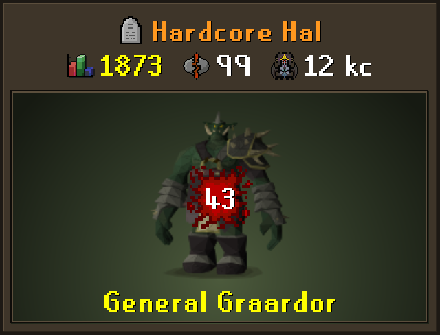
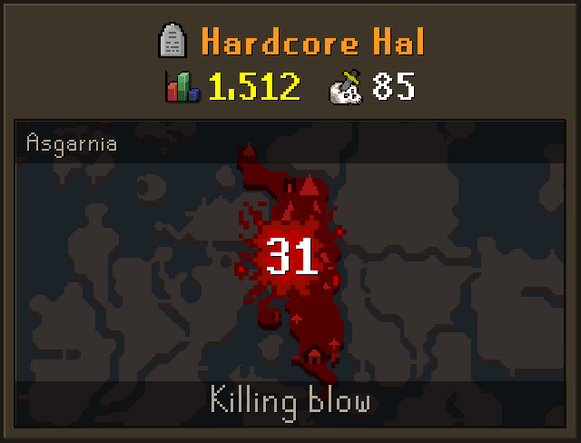
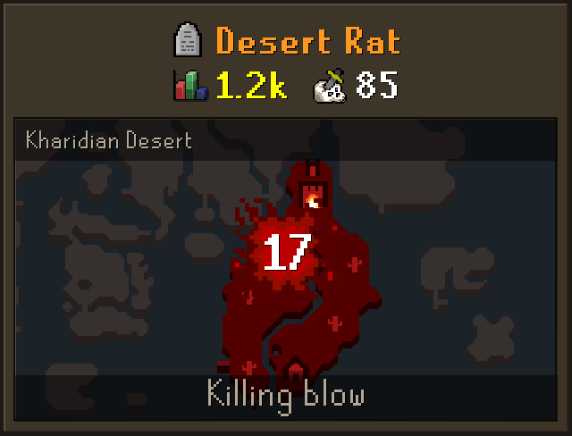
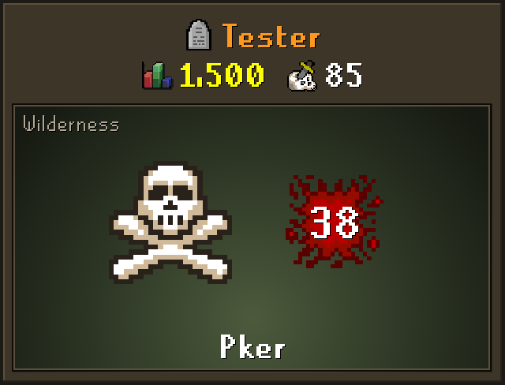

# Hardcore Death Cannon

When RuneLite receives a Hardcore Worlds death broadcast at or above your minimum total level, it plays the original cannon blast and memorial fanfare and shows a kill-cam memorial. Qualifying announcements play in order.

## Run locally

1. Open a terminal at the project root.
2. Run `gradle run` with a JDK and Gradle installed. `gradle test` runs the unit tests.
3. In the client, enable **Hardcore Death Cannon**. The default **Minimum total level** is **251**, the volume is **45%**, and the popup stays up for **5 seconds** at **71%** scale. Choose a duration from **1 to 15 seconds** and a scale from **50% to 150%**. The popup shrinks to fit smaller game viewports. A death exactly at the minimum plays, and **0** plays every broadcast. Volume 0 leaves the animation on.
4. While logged in, enter `::deathcannon` in game chat to preview the effect with your own character, your highest skill and a Goblin killer on any world. Hold **Alt** and drag the visible popup to move it. RuneLite saves the position. Actual broadcasts trigger on Hardcore Worlds.

Earlier versions had a **Total level threshold** that played totals strictly above it. On start-up a saved threshold is moved to **Minimum total level** as threshold + 1, so the same deaths keep playing.

Turn on **Compact gravestone** to show the player name, total level, and any clanmate label on the cache gravestone sprite. **Cannon sound** and **Memorial music** are separate switches. Choose the cues by entering OSRS cache sound effect IDs in **Cannon sound ID** and **Memorial sound ID**. Set either ID to `-1` to use the original cue. Custom cues use your in-game sound effects volume when it is audible and the plugin volume when that setting is muted. Set the plugin volume to 0 to mute both cues. Use the preview command to try your selections.

Memorials mark players on your own clan roster as **Clanmate**. Turn on **Clan only** to limit announcements and replays to clanmates. The same minimum total level applies.

Click the original death broadcast in chat to replay the memorial using your current settings. Replay entries are kept for the latest 100 qualifying broadcast texts during the current plugin session.

For a Jagex Account, open **Jagex Account** in the RuneLite sidebar, click **Add Jagex Account**, and complete sign-in in the window that opens. Select your character in the sidebar, then click **Play Now**. [RuneLite developer sign-in guide](https://github.com/runelite/runelite/wiki/Using-Jagex-Accounts)

## Kill-cam memorial

| NPC killer | No killer art: Asgarnia | No killer art: Kharidian Desert | Wilderness PK |
| --- | --- | --- | --- |
|  |  |  |  |

These previews were drawn by the plugin's own overlay code outside the game, from broadcasts ending `in Asgarnia`, `in the Kharidian Desert` and `in the Wilderness`. The Graardor model comes from the game cache through the plugin's renderer. The region maps are the bundled cache sprites described below, exactly as the plugin draws them in game.

The full memorial is a stone interface frame:

- **Top:** the player's name in orange, with RuneLite's Hardcore Worlds icon, and a **Clanmate** label when it applies.
- **Stats:** the total level with the Overall icon. With **Show highest skill** on, it also shows the highest skill and its icon. Highest means the highest level, and ties go to the skill with more XP. With **Show highest boss KC** on, it also shows the highest boss or raid kill count with that boss's icon. These are the same cache sprites RuneLite's HiScores panel shows.
- **Viewport:** the killer's model with the game's red damage hitsplat, showing the killing blow's damage. A 0 damage hit uses the blue hitsplat. The killer's name runs along the bottom. When the broadcast names no killer, it says **Killing blow** instead. The region at the end of the broadcast, such as `in Karamja` or `in the Wilderness`, is in the top-left corner. If the player has been seen, their cached portrait is in the top-right.
- **Map:** when there is no killer art, the viewport shows the broadcast's region highlighted on a world map, with the hitsplat over it. The view covers the whole region. No tile is marked, because the broadcast names only the region. The maps are Jagex's own Leagues area-menu sprites (cache sprites 8059–8070), which use the same region names: Misthalin, Karamja, Asgarnia, Kandarin, Morytania, Kharidian Desert, Tirannwn, Fremennik Province, Wilderness, Kourend & Kebos and Varlamore. A region outside that set is shown as text with no map. A broadcast that names no region gets no map and no location. A sighting never stands in for the place of death.
- **Wilderness PK:** when the killer is known to be a player and the broadcast places the death in the Wilderness, the viewport shows the game's PK skull on the left and the hitsplat on the right, with the killer's name in white. No player model is needed.

The hitsplats (cache sprites 1359 and 1358), the PK skull (cache sprite 439), the region maps (cache sprites 8059–8070) and the boss icons are exported from the Old School game cache and bundled with the plugin, like the skill icons. A boss added to the Hiscores after that export is shown by name with its count.

### Killer art

The broadcast gives only the killer's name, so the plugin looks for real game art in two places. Nothing is downloaded.

1. **Current scene:** an NPC with that name, preferring one interacting with the player who died, then a player with that name, then any other NPC with that name. Its live model is drawn.
2. **Game cache:** NPC definitions with that name in the local cache. Attackable definitions are preferred. Among those, the appearance shared by the most definitions is drawn, and ties go to the lowest NPC id. The definitions are indexed in small slices per client tick the first time a killer needs them.

The model is drawn by the plugin's small flat-shaded renderer, using the model's own triangles and colours. Textures are drawn as their lit shade, not as texture pixels. Killers that match nothing get no art. This covers player killers who are not in your scene, and names with no NPC definition. In that case the viewport shows the region map or the hitsplat alone, and no stand-in figure is drawn. Because several NPCs can share a name, the cache art can show a different variant from the one that dealt the blow.

A killer counts as a player only on evidence. Either a player with that name is in your scene, or no NPC definition has that name and the plugin has seen a player with it on a Hardcore World. A name that simply matches no NPC is not treated as a player. A player killer you have never seen is therefore drawn as an unknown killer, and the PK layout appears only when that evidence holds and the broadcast names the Wilderness.

## Broadcast coverage

The plugin reacts to broadcasts that Jagex sends to your client. It compares the total printed in the announcement with **Minimum total level**.

An abbreviated total such as `1.2k` can stand for several totals. Jagex's rounding is not documented, so the plugin allows for both truncation and rounding: `1.2k` covers 1150–1299, capped at the 2376 maximum. A death plays at once if the whole range is at or above the minimum, and is skipped if the whole range is below it. If the range straddles the minimum, the plugin waits up to 5 seconds for the player's Hardcore Worlds Hiscores total. It decides with that total if the total fits the abbreviation. Otherwise, or if the lookup fails or is slow, the memorial plays. A Hiscores total that fits also replaces the abbreviation on the memorial.

For qualifying broadcasts the plugin sends **one** asynchronous Hardcore Worlds Hiscores request. The result supplies the exact total, the highest skill and the highest boss KC. If the lookup is unavailable or too slow for the popup, those rows are left out, and the total from the broadcast still appears.

**Highest boss KC** counts only entries in the Hiscores boss section, which includes the raids. Clue scrolls, minigames and other activities are excluded. Jagex's boss section also lists skilling bosses such as Wintertodt and Tempoross, and chest counts such as Barrows Chests, so those count too. Raid variants such as Chambers of Xeric and Chambers of Xeric: Challenge Mode are separate Hiscores entries. Each is compared on its own and they are never added together. When two entries have the same kill count, the one listed first on the Hiscores wins, which puts a normal raid ahead of its harder variant. Unranked entries and counts of 0 are ignored, and the KC chip is left out when nothing is positive. Every current boss has a bundled icon. The chip shows the HiScores icon and kill count without a mode label. A newer boss is named with its count.

The memorial uses Old School bitmap fonts and keeps the original sprites' proportions at any popup scale. When a player's model is loaded in your scene, the plugin captures a flat-shaded portrait based on the model's shape and colours. It keeps up to 500 recent Hardcore Worlds sightings across world hops and RuneLite sessions. It saves new or updated sightings locally about every 30 seconds and on a normal exit. If a player dies elsewhere, the memorial shows their cached portrait. Where they were seen is never shown as the place of death. The date, world and tile are still saved with each sighting, but they are not shown. The cache lives in `.runelite/plugin-data/hardcore-death-cannon/sightings.dat.gz`.
